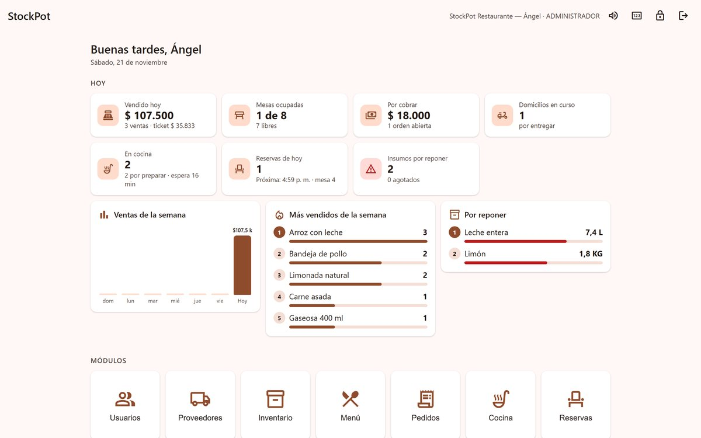
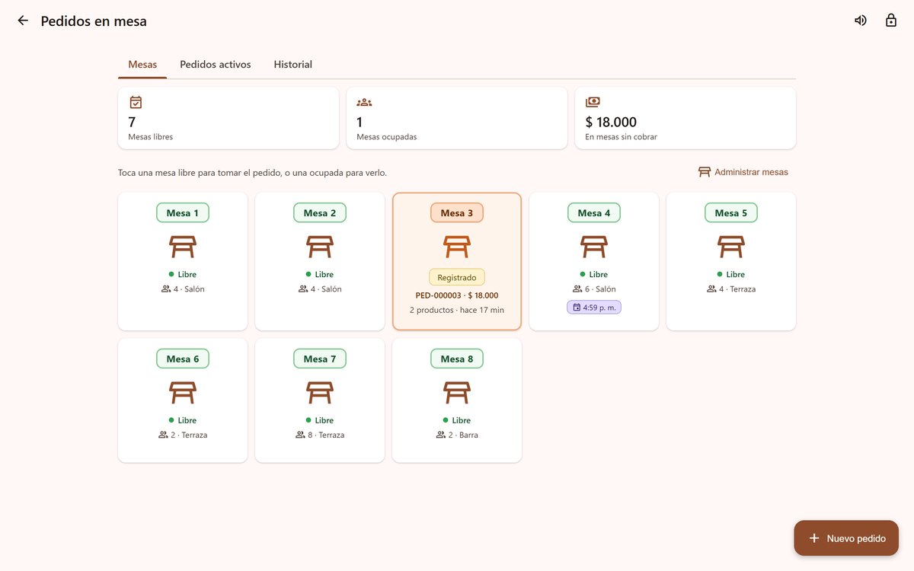
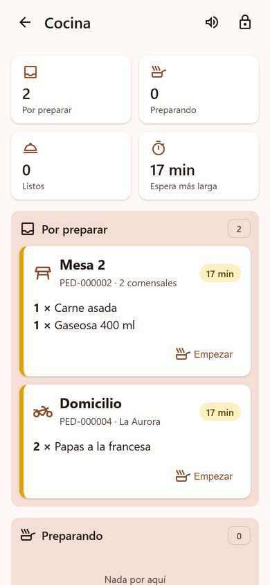
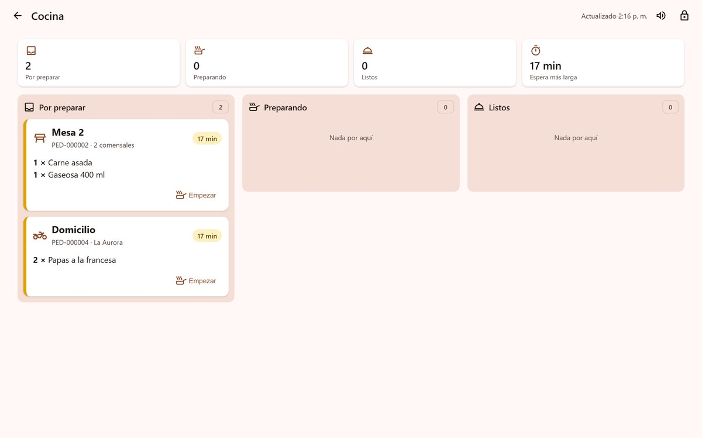
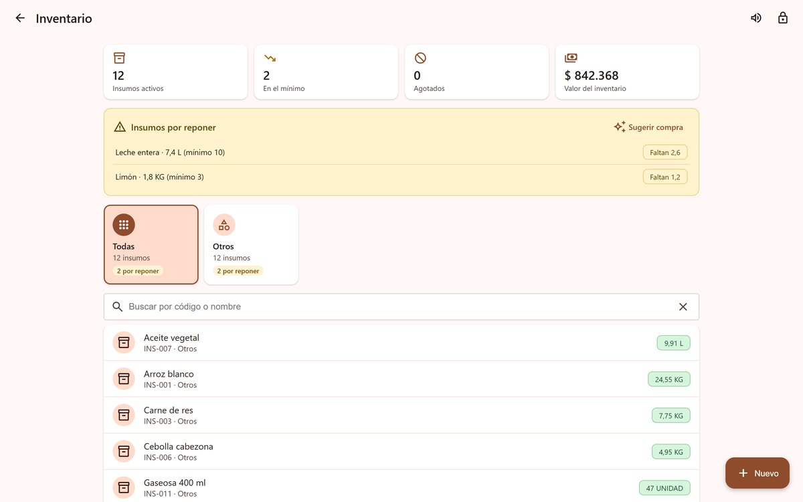
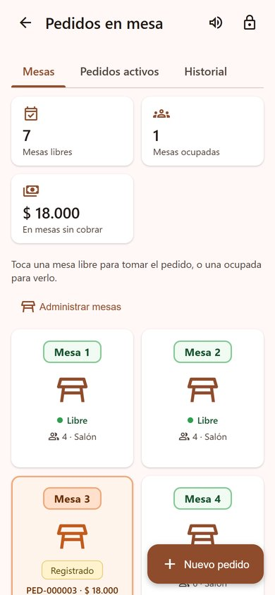
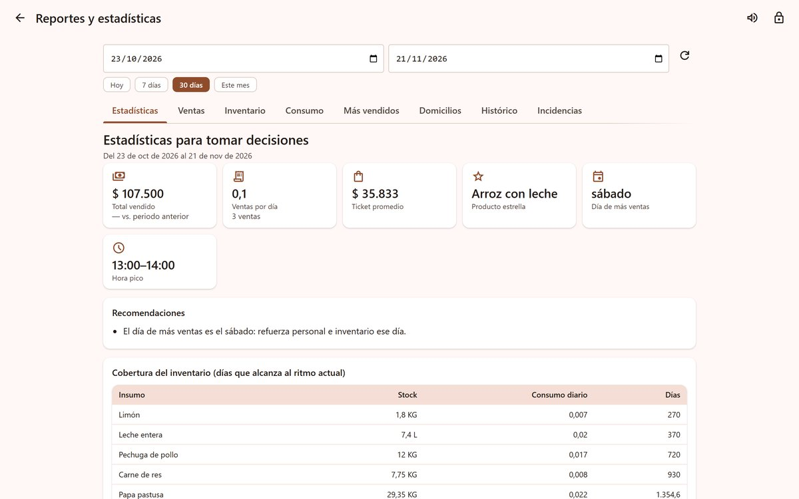

<div align="center">

# StockPot

**Sistema web de gestión de inventario, pedidos y ventas para restaurantes pequeños y medianos**

[](https://github.com/Angelssjyf/stockpot/actions/workflows/pruebas.yml)


Proyecto de Ingeniería del Software II · Universidad Simón Bolívar, sede Cúcuta · 2026-2<br>
Cliente: **Sexto Sentido Café & Brunch**



</div>

## ¿Qué es StockPot?

StockPot reúne en un solo sistema la operación diaria de un restaurante: el inventario de insumos, las
compras a proveedores, la carta, los pedidos en mesa y a domicilio, la cocina, las reservas, la caja y los
reportes. Cada plato vendido descuenta sus insumos según la receta, así el administrador sabe en todo
momento qué hay en bodega, qué se debe comprar y cuánto se vendió.

Muchos restaurantes pequeños llevan estos procesos en papel, cuadernos u hojas de cálculo sueltas, lo que
produce errores entre la sala y la cocina, insumos vencidos o agotados y decisiones sin datos. StockPot
reemplaza esos registros por información en tiempo real, con un rol y permisos para cada trabajador.

## Funcionalidades

| Módulo | Qué hace |
|---|---|
| **RF-01 Usuarios y roles** | Usuarios, 6 roles (administrador, mesero, cocinero, cajero, bodeguero y domiciliario) y permisos configurables |
| **RF-02 Proveedores y compras** | Proveedores, insumos que ofrece cada uno, órdenes de compra y sugerencia de compra por stock mínimo |
| **RF-03 Inventario** | Insumos por categoría, entradas y salidas, existencias y alertas de stock mínimo |
| **RF-04 Productos y menú** | Carta con recetas: cada plato sabe qué insumos consume |
| **RF-05 Pedidos en mesa** | Mapa de mesas, toma de pedidos, validación de insumos disponibles y envío a cocina |
| **RF-06 Cocina** | Tablero de comandas por llegada: por preparar, en preparación, listo y entregado |
| **RF-07 Reservas** | Reservas por fecha, hora y número de personas, con las mesas disponibles |
| **RF-08 Domicilios** | Clientes, asignación al domiciliario, estados del envío e historial |
| **RF-09 Pagos** | Cobro en efectivo, tarjeta o transferencia (también mixto), comprobante y cierre de caja |
| **RF-10 Ventas y consumo** | Ventas, productos más vendidos y consumo real de insumos |
| **RF-11 Reportes** | Inventario, ventas, consumo, productos, histórico y estadísticas |

La interfaz funciona en computador, tableta y celular.

<table>
<tr>
<td width="68%"><br><sub>Pedidos en mesa</sub></td>
<td rowspan="2" width="32%" align="center"><br><sub>Cocina en el celular</sub></td>
</tr>
<tr>
<td><br><sub>Tablero de cocina</sub></td>
</tr>
<tr>
<td><br><sub>Inventario de insumos</sub></td>
<td rowspan="2" align="center"><br><sub>Pedidos en el celular</sub></td>
</tr>
<tr>
<td><br><sub>Reportes</sub></td>
</tr>
</table>

## Arquitectura

```
Página web (HTML/CSS/JS)  ──HTTP/JSON + token JWT──►  API Flask (Python)  ──SQLAlchemy──►  MySQL 8.4
frontend/                                              backend/                             database/
```

| Capa | Tecnología |
|---|---|
| Base de datos | MySQL 8.4 LTS (27 tablas) |
| Backend (API REST) | Python 3.11, Flask, SQLAlchemy, Flask-JWT-Extended, Waitress |
| Presentación (interfaz web) | HTML, CSS y JavaScript sin frameworks, con diseño adaptable |
| Pruebas | pytest, pytest-cov, Google Lighthouse y GitHub Actions |
| Gestión | Scrum en 4 iteraciones, Jira, GanttProject y GitFlow |
| Despliegue | Waitress + ngrok desde el equipo del proyecto |

## Calidad

| Indicador | Resultado |
|---|---|
| Pruebas automatizadas | **438 aprobadas**, con pruebas de seguridad por rol en cada módulo |
| Cobertura del backend | **96 %** |
| Plan de pruebas funcionales | **88 casos CRUD** sobre los 11 módulos |
| Usabilidad (Google Lighthouse) | **100** en rendimiento, accesibilidad, buenas prácticas y SEO en 14 pantallas |
| Prueba de carga | 50 usuarios simultáneos, 1.000 peticiones, **0 errores**, percentil 95 de 0,48 s |
| Aceptación de usuarios (UAT) | 21 trabajadores de restaurante: **91 %** de tareas sin problema y satisfacción de **4,32 / 5** |

Las pruebas corren en GitHub Actions en cada envío a `main` y `develop`; solo se integra código si toda la
suite pasa.

## Equipo e iteraciones

| Iteración | Responsable | Módulos | Estado |
|---|---|---|---|
| 1 | Andrés Mateo Puentes | Usuarios y roles (RF-01) · Proveedores y compras (RF-02) | ✅ Terminado |
| 2 | Jhorman Caballero | Inventario (RF-03) · Productos y menú (RF-04) | ✅ Terminado |
| 3 | Yovany Peñaranda | Pedidos en mesa (RF-05) · Cocina (RF-06) · Reservas (RF-07) | ✅ Terminado |
| 4 | Ángel David Rodríguez Vega (líder) | Domicilios (RF-08) · Pagos (RF-09) · Ventas y consumo (RF-10) · Reportes (RF-11) | ✅ Terminado |

También integra el equipo Jhan Carlos Urbina. Docente: Ing. Nataly Duque Páez.

| Entrega | Alcance | Puntos de función |
|---|---|---|
| 2.º corte (20/10/2026) | 70 %: Iteraciones 1, 2 y 4 | 233 de 330 |
| 3.er corte (13/11/2026) | + 15 %: Pedidos (RF-05) y Cocina (RF-06) | 301 de 330 |
| **Entrega final (24/11/2026)** | **100 %**: + Reservas (RF-07) | **330 de 330** |

**Versión entregada:** [`v1.0.0`](https://github.com/Angelssjyf/stockpot/tree/v1.0.0) en la rama `main`, en línea
con ngrok desde el equipo del proyecto ([guía de despliegue](docs/despliegue/Guia_Despliegue_ngrok.md)).

## Gestión del proyecto

| Qué | Dónde |
|---|---|
| Tablero de tareas | [Jira – proyecto STOC](https://mateopuentes1227.atlassian.net/jira/software/projects/STOC/boards/34): 166 tareas, todas en Listo |
| Cronograma | [Cronograma_StockPot.gan](docs/entrega-final/01_Plan_de_gestion_del_proyecto/Cronograma_StockPot.gan) (GanttProject) al 100 % |
| Duración | 10/08/2026 – 24/11/2026 · lunes a sábado, sin domingos ni festivos de Colombia |
| Estimación | 458,35 puntos de función ajustados (2.750 horas), PERT y COCOMO II ([Excel](docs/entrega-final/01_Plan_de_gestion_del_proyecto)) |
| Presupuesto | BAC de $205.875.739 con salarios de referencia de Bogotá; control con valor ganado (SPI final de 1,00) |

## Estructura del proyecto

```
stockpot/
├── database/            Scripts SQL
│   ├── 01_schema.sql    Crea la base y sus 27 tablas (instalación desde cero)
│   ├── 02_seed.sql      Roles y permisos iniciales
│   ├── 03_usuario_app.sql   Usuario de MySQL para la aplicación
│   ├── 04_datos_ejemplo.sql Datos de demostración (insumos, proveedores, carta, clientes)
│   └── 05 a 17_*.sql    Actualizan una base existente sin borrar datos
├── backend/             API Flask
│   ├── app/
│   │   ├── models/      Tablas como clases de Python
│   │   ├── modules/     Un módulo por cada requisito de la EDT (usuarios, inventario, pagos...)
│   │   ├── services/    Reglas compartidas (inventario, órdenes, ventas, compras y restaurantes)
│   │   └── utils/       Código compartido (permisos, sesión, fechas)
│   ├── tests/           Pruebas automáticas (casos CP-XX.X-n)
│   ├── requirements.txt     Lo que necesita la app
│   └── requirements-dev.txt Lo anterior + pytest (solo para programar)
├── frontend/            Interfaz web (la sirve Flask)
│   ├── index.html       Inicio de sesión
│   ├── menu.html        Menú de módulos según el rol
│   ├── *.html           Una pantalla por módulo (usuarios, inventario, domicilios, caja...)
│   ├── css/estilos.css  Diseño de toda la interfaz
│   └── js/              Lógica de cada pantalla (api.js habla con la API)
├── docs/                Documentación (modelo de datos, despliegue y entregables de cada corte)
└── iniciar.bat          Enciende el servidor y el enlace público de ngrok
```

---

## Instalación (para cada integrante)

### 1. Requisitos
Instala: **Python 3.11**, **Git**, **MySQL Server 8.4 LTS**, **MySQL Workbench** y **VS Code**.

### 2. Clonar el repositorio

```powershell
git clone https://github.com/Angelssjyf/stockpot.git
cd stockpot
git checkout develop
```

### 3. Crear la base de datos
En MySQL Workbench, conectado como `root`, ejecuta en este orden (rayo ⚡):

1. `database/01_schema.sql`: crea la base `stockpot`. ⚠️ Borra la base si ya existe.
2. `database/02_seed.sql`: roles y permisos.
3. `database/03_usuario_app.sql`: **antes de ejecutarlo**, cambia `CAMBIA_ESTA_CLAVE` por una
   contraseña tuya, solo en el editor de Workbench. No guardes el archivo con la clave.
4. *(Opcional)* `database/04_datos_ejemplo.sql`: insumos, proveedores, 8 platos con sus recetas y
   3 clientes y 8 mesas de ejemplo. Se puede ejecutar más de una vez sin duplicar datos.

Verifica con `SHOW TABLES FROM stockpot;`: deben salir 27 tablas.

**¿Ya tenías la base creada de antes?** No vuelvas a ejecutar el `01` (borra todo). Ejecuta solo
los scripts de actualización que te falten, en orden numérico, del `05` al `17`
(por ejemplo `09_iteracion3_pedidos.sql` y `15_reservas.sql`).
Solo agregan columnas y tablas; tus datos se conservan.

### 4. Configurar el backend

```powershell
cd backend
python -m venv .venv
.venv\Scripts\activate
pip install -r requirements.txt
Copy-Item .env.example .env
```

Abre `backend/.env` y llena `DB_PASSWORD` (la clave de `stockpot_app`) y `SECRET_KEY`. Para
generar la `SECRET_KEY`:

```powershell
python -c "import secrets; print(secrets.token_hex(32))"
```

> 🔒 El archivo `.env` **nunca se sube** a GitHub (está en `.gitignore`). No compartas su contenido.

Si PowerShell no deja activar el entorno (*"la ejecución de scripts está deshabilitada"*), ejecuta
primero `Set-ExecutionPolicy -Scope Process -ExecutionPolicy RemoteSigned`.

### 5. Crear tu usuario administrador

```powershell
flask crear-admin
```

Te pedirá correo, nombre y contraseña (mínimo 8 caracteres). Con ese usuario inicias sesión.

### 6. Ejecutar

1. Doble clic en **`iniciar.bat`**: enciende **todo de una vez**:
   - el servidor de producción **Waitress** (sin modo debug),
   - el **enlace público de ngrok**, si está instalado; aparece en verde y se copia al portapapeles,
   - y abre **http://127.0.0.1:5000** en tu navegador con la interfaz web.
2. Para apagar todo, cierra la ventana negra del servidor y la de ngrok.

La interfaz web no se compila: al cambiar un archivo de `frontend/`, basta con recargar el
navegador (F5).

> 🔄 **Si cambió algo de Python (`backend/`), cierra la ventana del servidor y vuelve a abrir
> `iniciar.bat`.** El servidor carga el código una sola vez al arrancar; si no lo reinicias, las
> pantallas nuevas muestran *"La ruta de la API no existe"*.

Para comprobar solo la API: http://127.0.0.1:5000/api/health debe responder con la versión de
MySQL y los roles.

### Enlace público con ngrok

Paso a paso, con la arquitectura, la seguridad y los problemas frecuentes:
[docs/despliegue/Guia_Despliegue_ngrok.md](docs/despliegue/Guia_Despliegue_ngrok.md).

1. Instala [ngrok](https://ngrok.com/download) y vincula tu cuenta una sola vez:
   `ngrok config add-authtoken <tu-token>` (el token está en dashboard.ngrok.com).
2. **Enlace fijo (recomendado):** reclama tu dominio gratuito en dashboard.ngrok.com → *Domains*
   y escríbelo en un archivo `ngrok-dominio.txt` junto a `iniciar.bat` (solo el dominio, por ejemplo
   `mi-stockpot.ngrok-free.app`). Si no existe ese archivo, el enlace cambia cada vez.

Quien abra el enlace verá primero una advertencia de ngrok: debe tocar **Visit Site**.

> ⚠️ Mientras `iniciar.bat` esté abierto, cualquiera con el enlace puede ver la pantalla de
> login. Usa contraseñas fuertes y cierra las ventanas cuando no lo estén usando.

### Copias de seguridad de la base de datos

Cada vez que se abre `iniciar.bat` se hace una copia de la base MySQL en `database/respaldos/`
(carpeta que no se sube a GitHub). Se guardan las **últimas 15** copias automáticas
(`stockpot_auto_AAAA-MM-DD_HHMMSS.sql`); las copias hechas a mano con otro nombre no se borran.

- **Hacer una copia en cualquier momento** (en `backend`): `flask respaldar`
- **Restaurar una copia** (reemplaza los datos actuales):
  `mysql -u root -p stockpot < ..\database\respaldos\stockpot_auto_AAAA-MM-DD_HHMMSS.sql`

Si `mysqldump` no está en la ruta normal de MySQL, pon su ubicación en `MYSQLDUMP` dentro de `backend/.env`.

### Registro de eventos y errores

El servidor anota en `backend/logs/stockpot.log` (no se sube a GitHub; rota a 1 MB y guarda 5 anteriores):

- **ERROR**: fallas inesperadas con su detalle técnico. El usuario ve *«Ocurrió un error inesperado
  (código A1B2C3)»*; busca ese código en el archivo para ver qué pasó.
- **WARNING**: eventos de seguridad (sin sesión, sin permiso, sesión bloqueada, demasiados intentos de
  inicio de sesión) y peticiones que tardan más de 2 segundos.
- **INFO**: arranque del servidor y copias de seguridad.

Nunca se anotan contraseñas, tokens ni el contenido de las peticiones.

### Para programar

- **Backend con recarga automática:** en vez de `iniciar.bat`, ejecuta en `backend`:
  `python run.py` (modo debug, **solo local, nunca con ngrok**).
- **Interfaz web:** edita los archivos de `frontend/` y recarga el navegador (F5). Si no ves
  el cambio, recarga forzando con `Ctrl+F5`.

### 7. Correr las pruebas

Las herramientas de pruebas no van en el servidor: se instalan aparte, una sola vez.

```powershell
pip install -r requirements-dev.txt
pytest -v
```

Las pruebas usan una base SQLite temporal en memoria: no tocan tu base MySQL.

---

## API disponible

Todas las rutas, excepto `login` y `health`, requieren el encabezado
`Authorization: Bearer <token>`.

| Método | Ruta | Requisito | Permiso |
|---|---|---|---|
| GET | `/api/health` | Estado de la API y de la base de datos | — |
| POST | `/api/auth/login` | RF-01.4 Iniciar sesión | — |
| GET | `/api/auth/me` | Usuario de la sesión | Sesión iniciada |
| GET | `/api/usuarios?q=` | RF-01.2 Consultar usuarios | `usuarios.ver` |
| GET | `/api/usuarios/<id>` | RF-01.2 Detalle de un usuario | `usuarios.ver` |
| POST | `/api/usuarios` | RF-01.1 Registrar usuarios | `usuarios.gestionar` |
| PUT | `/api/usuarios/<id>` | RF-01.3 Modificar usuarios | `usuarios.gestionar` |
| PATCH | `/api/usuarios/<id>/rol` | RF-01.5 Asignar roles | `roles.gestionar` |
| GET | `/api/roles` | RF-01.6 Roles con sus permisos | `usuarios.ver` |
| GET | `/api/permisos` | RF-01.6 Permisos disponibles | `roles.gestionar` |
| PUT | `/api/roles/<id>/permisos` | RF-01.6 Gestionar permisos de un rol | `roles.gestionar` |
| GET/POST/PUT | `/api/proveedores` · `/api/proveedores/<id>/insumos` · `/compras` | RF-02.1 a RF-02.5 | `proveedores.*` |
| GET/POST/PATCH | `/api/ordenes-compra` · `/<id>/estado` | RF-02.6 a RF-02.8 | `compras.*` |
| GET/POST | `/api/ordenes-compra/sugerencia` | Sugerencia de compra (stock mínimo → órdenes por proveedor) | `compras.*` |
| GET/POST/PUT | `/api/insumos` · `/api/insumos/<id>/movimientos` | RF-03.1 a RF-03.5, RF-03.7 | `inventario.*` |
| GET | `/api/inventario/existencias` · `/api/inventario/alertas` | RF-03.6 y RF-03.8 | `inventario.ver` |
| GET/POST/PUT/PATCH | `/api/productos` · `/<id>/disponibilidad` | RF-04.1 a RF-04.6 | `productos.*` |
| GET/POST/PUT | `/api/mesas` · `/api/mesas/<id>` | RF-05.2 Mesas del salón (libres u ocupadas) | `pedidos.*` |
| GET/POST/PUT | `/api/pedidos` · `/<id>` · `/<id>/productos` | RF-05.1 a RF-05.5 Registrar, agregar productos, modificar y consultar | `pedidos.*` |
| POST | `/api/pedidos/disponibilidad` | RF-05.6 Validar disponibilidad de insumos (sin guardar) | `pedidos.ver` |
| PATCH/GET | `/api/pedidos/<id>/confirmar` · `/enviar-cocina` · `/comanda` · `/estado` · `/cancelar` | RF-05.7 a RF-05.9 | `pedidos.*` |
| GET | `/api/cocina/ordenes` | RF-06.1 a RF-06.3 Recibir y ver las órdenes pendientes por llegada | `cocina.ver` |
| PATCH | `/api/cocina/ordenes/<MESA\|DOMICILIO>/<id>/estado` | RF-06.4 a RF-06.6 En preparación, listo y entregado | `cocina.gestionar` (entregado también `pedidos.gestionar`) |
| GET | `/api/cocina/novedades?desde=` | RF-06.7 Notificar cambios de estado | `cocina.ver` / `pedidos.ver` |
| GET/POST/PUT/PATCH | `/api/reservas` · `/<id>` · `/<id>/cancelar` · `/<id>/estado` | RF-07.1 a RF-07.5, RF-07.8 | `reservas.*` |
| GET | `/api/reservas/disponibilidad` | RF-07.6 y RF-07.7 Mesas libres para una fecha, hora y número de personas | `reservas.ver` |
| GET/POST/PUT | `/api/clientes` · `/api/domicilios` (+ `asignar`, `estado`, `entrega`, `historial`) | RF-08.1 a RF-08.8 | `domicilios.*` |
| GET/POST/PATCH | `/api/ordenes/por-cobrar` · `/<id>/cuenta` · `/<id>/pagos` · `/<id>/comprobante` · `/api/pagos` | RF-09.1 a RF-09.7 | `pagos.*` |
| GET/POST | `/api/caja/turno` · `/api/caja/abrir` · `/api/caja/cerrar` · `/api/caja/turnos` · `/api/caja/turnos/<id>` | Cierre de caja (arqueo) | `pagos.*` |
| GET/POST | `/api/ventas` · `/mas-vendidos` · `/consumo` | RF-10.1 a RF-10.6 | `ventas.ver` / `pagos.gestionar` |
| GET | `/api/reportes/inventario` · `ventas` · `consumo` · `productos` · `historico` · `estadisticas` | RF-11.1 a RF-11.6 | `reportes.ver` |

Códigos de respuesta: `200/201` correcto · `401` sin sesión · `403` sin permiso ·
`404` no existe · `409` conflicto (duplicado o regla de negocio) · `422` datos inválidos.

---

## Cómo trabajamos (GitFlow)

| Rama | Para qué |
|---|---|
| `main` | Versiones entregadas (etiquetas `v0.7` a `v1.0.0`) |
| `develop` | Integración del trabajo del equipo |
| `feature/RF-XX-nombre` | Un requisito o módulo; sale de `develop` y vuelve por Pull Request |

```powershell
git checkout develop
git pull
git checkout -b feature/RF-02-proveedores
# ... programar, probar ...
git add .
git commit -m "feat(proveedores): registrar proveedores [RF-02.1]"
git push -u origin feature/RF-02-proveedores
```

Después abre un **Pull Request hacia `develop`** en GitHub para que otro integrante lo revise.

**Mensajes de commit:** `tipo(módulo): qué hace [RF-XX.X]`. Tipos: `feat` (funcionalidad),
`fix` (corrección), `test` (pruebas), `docs` (documentación), `db` (scripts SQL).

**Antes de cada Pull Request:**
- [ ] `pytest` pasa completo.
- [ ] Cada ruta nueva indica en su docstring el `RF-XX.X` que implementa.
- [ ] Cada requisito nuevo tiene al menos un caso de prueba `CP-XX.X-n`.
- [ ] Si cambiaste tablas, actualizaste `database/01_schema.sql` **y** `backend/app/models/`.

---

## Despliegue

StockPot se publica con **ngrok** desde el PC del equipo (opción aprobada por la docente):
[Guía de despliegue con ngrok](docs/despliegue/Guia_Despliegue_ngrok.md).

## Documentación de las entregas

Los entregables de cada corte están en `docs/`, organizados según las secciones de procesos
técnicos y de soporte de IEEE 1058 (cada carpeta tiene su README):

| Entrega | Carpeta | Contenido |
|---|---|---|
| 2.º corte (70 %) | [docs/entrega-2do-corte](docs/entrega-2do-corte) | Acta de constitución · cronograma de GanttProject · Excel de puntos de función y PERT · enlace de Jira · prompts e IA utilizada · plan de pruebas CRUD · matriz de criterios de aceptación · informe de pruebas · acta UAT · video y presentación de la demostración |
| 3.er corte (70 % + 15 %) | [docs/entrega-3er-corte](docs/entrega-3er-corte) | Acta de constitución v0.3 · Excel con el presupuesto en un solo cálculo (BAC) · plan de pruebas de 78 casos · informe de pruebas del 15 % · guía de despliegue con ngrok |
| Entrega final (100 %) | [docs/entrega-final](docs/entrega-final) | Acta de constitución v1.0 con mockups · cronograma y Jira al 100 % · plan de pruebas de 88 casos · informe de pruebas final · matriz de criterios de aceptación · COCOMO II + EVM + SQA · pruebas de usabilidad con Lighthouse · acta UAT · enlace del despliegue · presentación y videos · código fuente v1.0.0 |

Documentación técnica: [modelo de datos](docs/modelo-datos.md) ·
[guía de despliegue con ngrok](docs/despliegue/Guia_Despliegue_ngrok.md).
