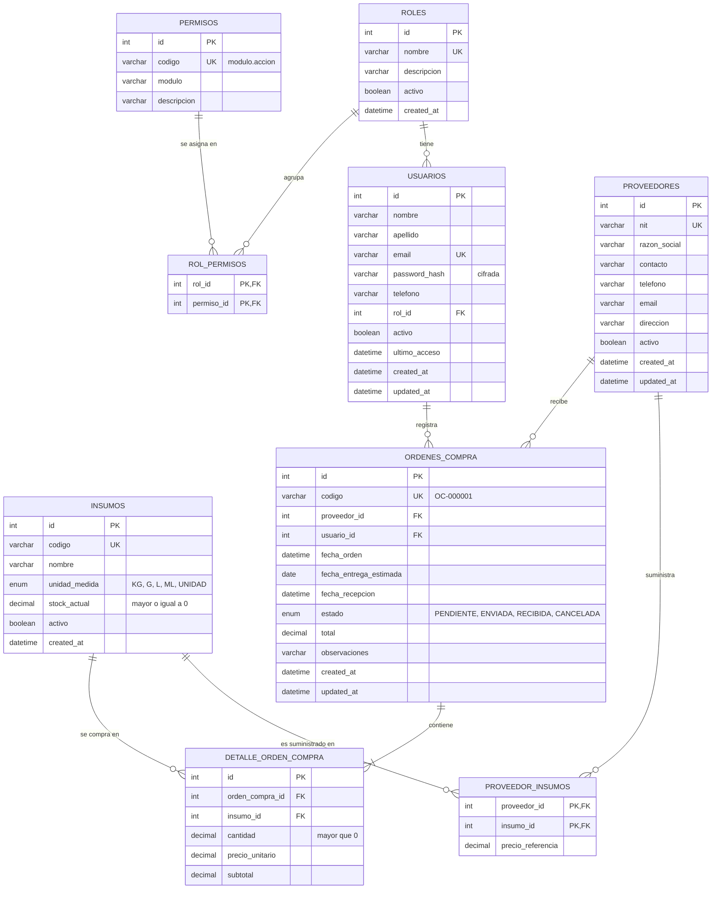

# Modelo de datos — StockPot

Diagrama entidad-relación de la base `stockpot` (MySQL 8.4): 21 tablas, generado a partir de
[`database/01_schema.sql`](../database/01_schema.sql). Si cambia el script, se actualiza
también este diagrama.

**Convenciones:** `PK` llave primaria · `FK` llave foránea · `UK` valor único.

## Modelo completo actual (21 tablas)

Incluye las Iteraciones 1, 2 y 4 (entregadas en el 70 %) y los pedidos en mesa de la Iteración 3.
GitHub dibuja el diagrama a partir de este código. Se generó desde los modelos de
`backend/app/models/`, así que coincide campo por campo con la base.

**Cardinalidad:** `||--o{` uno a cero o muchos · `||--o|` uno a cero o uno.

```mermaid
erDiagram
    CLIENTES ||--o{ DOMICILIOS : "cliente_id"
    CLIENTES ||--o{ ORDENES : "cliente_id"
    INSUMOS ||--o{ CONSUMOS : "insumo_id"
    INSUMOS ||--o{ DETALLE_ORDEN_COMPRA : "insumo_id"
    INSUMOS ||--o{ MOVIMIENTOS_INVENTARIO : "insumo_id"
    INSUMOS ||--o{ PROVEEDOR_INSUMOS : "insumo_id"
    INSUMOS ||--o{ RECETAS : "insumo_id"
    MESAS ||--o{ PEDIDOS_MESA : "mesa_id"
    MOVIMIENTOS_INVENTARIO ||--o{ CONSUMOS : "movimiento_id"
    ORDENES ||--o{ DETALLE_ORDENES : "orden_id"
    ORDENES ||--o{ PAGOS : "orden_id"
    ORDENES ||--o| DOMICILIOS : "orden_id"
    ORDENES ||--o| PEDIDOS_MESA : "orden_id"
    ORDENES ||--o| VENTAS : "orden_id"
    ORDENES_COMPRA ||--o{ DETALLE_ORDEN_COMPRA : "orden_compra_id"
    ORDENES_COMPRA ||--o{ MOVIMIENTOS_INVENTARIO : "orden_compra_id"
    PERMISOS ||--o{ ROL_PERMISOS : "permiso_id"
    PRODUCTOS ||--o{ DETALLE_ORDENES : "producto_id"
    PRODUCTOS ||--o{ RECETAS : "producto_id"
    PROVEEDORES ||--o{ ORDENES_COMPRA : "proveedor_id"
    PROVEEDORES ||--o{ PROVEEDOR_INSUMOS : "proveedor_id"
    ROLES ||--o{ ROL_PERMISOS : "rol_id"
    ROLES ||--o{ USUARIOS : "rol_id"
    USUARIOS ||--o{ DOMICILIOS : "domiciliario_id"
    USUARIOS ||--o{ MOVIMIENTOS_INVENTARIO : "usuario_id"
    USUARIOS ||--o{ ORDENES : "usuario_id"
    USUARIOS ||--o{ ORDENES_COMPRA : "usuario_id"
    USUARIOS ||--o{ PAGOS : "usuario_id"
    USUARIOS ||--o{ VENTAS : "usuario_id"
    VENTAS ||--o{ CONSUMOS : "venta_id"

    CLIENTES {
        int id PK
        varchar nombre
        varchar telefono UK
        varchar email
        varchar direccion
        varchar barrio
        varchar referencia
        datetime created_at
    }
    INSUMOS {
        int id PK
        varchar codigo UK
        varchar nombre
        enum unidad_medida "KG, G, L, ML, UNIDAD"
        decimal stock_actual
        decimal stock_minimo
        decimal costo_unitario
        boolean activo
        datetime created_at
    }
    MESAS {
        int id PK
        int numero UK
        int capacidad
        varchar ubicacion
        boolean activa
        datetime created_at
    }
    PERMISOS {
        int id PK
        varchar codigo UK
        varchar modulo
        varchar descripcion
    }
    PRODUCTOS {
        int id PK
        varchar codigo UK
        varchar nombre
        varchar descripcion
        enum categoria "ENTRADA, PLATO_FUERTE, BEBIDA, POSTRE, ADICIONAL"
        decimal precio_venta
        boolean disponible
        boolean activo
        datetime created_at
    }
    PROVEEDORES {
        int id PK
        varchar nit UK
        varchar razon_social
        varchar contacto
        varchar telefono
        varchar email
        varchar direccion
        boolean activo
        datetime created_at
        datetime updated_at
    }
    ROLES {
        int id PK
        varchar nombre UK
        varchar descripcion
        boolean activo
        datetime created_at
    }
    PROVEEDOR_INSUMOS {
        int proveedor_id PK, FK
        int insumo_id PK, FK
        decimal precio_referencia
    }
    RECETAS {
        int producto_id PK, FK
        int insumo_id PK, FK
        decimal cantidad
    }
    ROL_PERMISOS {
        int rol_id PK, FK
        int permiso_id PK, FK
    }
    USUARIOS {
        int id PK
        varchar nombre
        varchar apellido
        varchar email UK
        varchar password_hash
        varchar telefono
        int rol_id FK
        boolean activo
        datetime ultimo_acceso
        datetime created_at
        datetime updated_at
    }
    ORDENES {
        int id PK
        varchar codigo UK
        enum tipo "MESA, DOMICILIO, LLEVAR"
        enum estado "ABIERTA, CERRADA, CANCELADA"
        int cliente_id FK
        int usuario_id FK
        decimal subtotal
        varchar observaciones
        datetime created_at
    }
    ORDENES_COMPRA {
        int id PK
        varchar codigo UK
        int proveedor_id FK
        int usuario_id FK
        datetime fecha_orden
        date fecha_entrega_estimada
        datetime fecha_recepcion
        enum estado "PENDIENTE, ENVIADA, RECIBIDA, CANCELADA"
        decimal total
        varchar observaciones
        datetime created_at
        datetime updated_at
    }
    DETALLE_ORDEN_COMPRA {
        int id PK
        int orden_compra_id FK
        int insumo_id FK
        decimal cantidad
        decimal precio_unitario
        decimal subtotal
    }
    DETALLE_ORDENES {
        int id PK
        int orden_id FK
        int producto_id FK
        int cantidad
        decimal precio_unitario
        decimal subtotal
        varchar observacion
    }
    DOMICILIOS {
        int id PK
        int orden_id FK, UK
        int cliente_id FK
        varchar direccion
        varchar barrio
        varchar referencia
        varchar telefono_contacto
        decimal costo_envio
        enum estado "RECIBIDO, EN_PREPARACION, LISTO, EN_CAMINO, ENTREGADO, CANCELADO"
        int domiciliario_id FK
        datetime fecha_asignacion
        datetime fecha_salida
        datetime fecha_entrega
        varchar recibido_por
        varchar observacion_entrega
        datetime created_at
    }
    MOVIMIENTOS_INVENTARIO {
        int id PK
        int insumo_id FK
        enum tipo "ENTRADA, SALIDA"
        enum motivo "COMPRA, AJUSTE, DEVOLUCION, CONSUMO, MERMA"
        decimal cantidad
        decimal stock_resultante
        int orden_compra_id FK
        int usuario_id FK
        varchar observacion
        datetime created_at
    }
    PAGOS {
        int id PK
        int orden_id FK
        enum metodo "EFECTIVO, TARJETA, TRANSFERENCIA"
        decimal monto
        decimal recibido
        decimal cambio
        varchar referencia
        enum estado "APROBADO, ANULADO"
        int usuario_id FK
        datetime created_at
    }
    PEDIDOS_MESA {
        int id PK
        int orden_id FK, UK
        int mesa_id FK
        int comensales
        enum estado "REGISTRADO, CONFIRMADO, EN_COCINA, EN_PREPARACION, LISTO, ENTREGADO, CANCELADO"
        datetime fecha_confirmacion
        datetime fecha_envio_cocina
        datetime fecha_listo
        datetime fecha_entrega
        datetime created_at
    }
    VENTAS {
        int id PK
        varchar codigo UK
        int orden_id FK, UK
        decimal subtotal
        decimal costo_envio
        decimal total
        decimal costo_insumos
        int usuario_id FK
        datetime created_at
    }
    CONSUMOS {
        int id PK
        int venta_id FK
        int insumo_id FK
        decimal cantidad
        decimal costo_unitario
        int movimiento_id FK
    }
```

## Iteración 1 — Usuarios y roles + Proveedores (diagrama original)

Código fuente del diagrama (Mermaid)

La imagen de arriba se genera a partir de este código. Si cambian las tablas, se edita
este bloque y se vuelve a generar la imagen.

## Multiplicidades (Iteración 1)

| Relación | Multiplicidad | Lectura |
|---|---|---|
| Rol – Usuario | 1 — 0..* | Un rol lo tienen cero o muchos usuarios; cada usuario tiene exactamente un rol |
| Rol – Permiso | * — * | Un rol tiene muchos permisos y un permiso puede estar en muchos roles (tabla `rol_permisos`) |
| Proveedor – Insumo | * — * | Un proveedor suministra varios insumos y un insumo puede comprarse a varios proveedores (tabla `proveedor_insumos`) |
| Proveedor – Orden de compra | 1 — 0..* | Un proveedor recibe cero o muchas órdenes; cada orden es para un solo proveedor |
| Usuario – Orden de compra | 1 — 0..* | Un usuario registra cero o muchas órdenes; cada orden la registra un solo usuario |
| Orden de compra – Detalle | 1 — 1..* | Una orden tiene una o más líneas; cada línea pertenece a una sola orden |
| Insumo – Detalle | 1 — 0..* | Un insumo aparece en cero o muchas líneas de compra; cada línea es de un solo insumo |

## Correspondencia ILF → tablas

| ILF (Análisis de Puntos de Función) | Tablas | Iteración |
|---|---|---|
| ILF01 Usuarios | `usuarios` | 1 |
| ILF02 Roles y permisos | `roles`, `permisos`, `rol_permisos` | 1 |
| ILF03 Proveedores | `proveedores`, `proveedor_insumos` | 1 |
| ILF04 Insumos | `insumos` (versión básica en la Iteración 1; stock mínimo y costo en la 2) | 1 → 2 |
| ILF05 Movimientos de inventario | `movimientos_inventario` | 2 |
| ILF06 Productos y platos | `productos` | 2 |
| ILF07 Recetas | `recetas` | 2 |
| ILF08 Mesas | `mesas` | 3 |
| ILF09 Pedidos | `ordenes` (domicilio, mesa o para llevar) y `pedidos_mesa` (datos propios del pedido en mesa) | 4 y 3 |
| ILF10 Detalle de pedidos | `detalle_ordenes` | 4 y 3 |
| ILF11 Reservas | — (pendiente, RF-07) | 3 |
| ILF12 Clientes | `clientes` | 4 |
| ILF13 Domicilios | `domicilios` | 4 |
| ILF14 Pagos | `pagos` | 4 |
| ILF15 Ventas | `ventas` | 4 |
| ILF16 Consumo | `consumos` | 4 |
| ILF17 Órdenes de compra | `ordenes_compra`, `detalle_orden_compra` | 1 |
