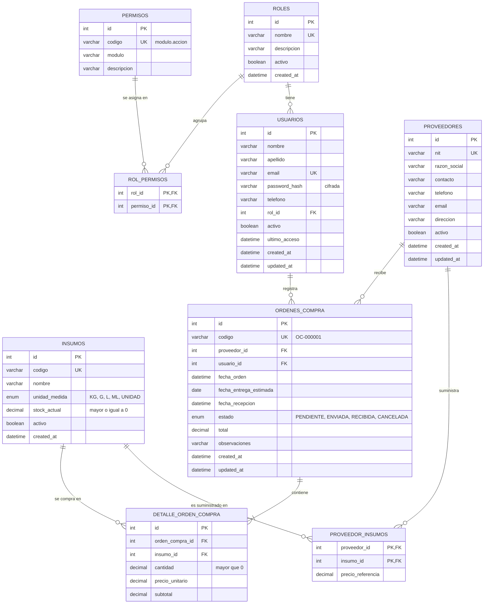

# Modelo de datos — StockPot

Diagrama entidad-relación de la base `stockpot` (MySQL 8.4), generado a partir de
[`database/01_schema.sql`](../database/01_schema.sql). Si cambia el script, se actualiza
también este diagrama.

**Convenciones:** `PK` llave primaria · `FK` llave foránea · `UK` valor único.

## Iteración 1 — Usuarios y roles + Proveedores

Código fuente del diagrama (Mermaid)

La imagen de arriba se genera a partir de este código. Si cambian las tablas, se edita
este bloque y se vuelve a generar la imagen.

## Multiplicidades

| Relación | Multiplicidad | Lectura |
|---|---|---|
| Rol – Usuario | 1 — 0..* | Un rol lo tienen cero o muchos usuarios; cada usuario tiene exactamente un rol |
| Rol – Permiso | * — * | Un rol tiene muchos permisos y un permiso puede estar en muchos roles (tabla `rol_permisos`) |
| Proveedor – Insumo | * — * | Un proveedor suministra varios insumos y un insumo puede comprarse a varios proveedores (tabla `proveedor_insumos`) |
| Proveedor – Orden de compra | 1 — 0..* | Un proveedor recibe cero o muchas órdenes; cada orden es para un solo proveedor |
| Usuario – Orden de compra | 1 — 0..* | Un usuario registra cero o muchas órdenes; cada orden la registra un solo usuario |
| Orden de compra – Detalle | 1 — 1..* | Una orden tiene una o más líneas; cada línea pertenece a una sola orden |
| Insumo – Detalle | 1 — 0..* | Un insumo aparece en cero o muchas líneas de compra; cada línea es de un solo insumo |

## Correspondencia ILF → tablas

| ILF (Análisis de Puntos de Función) | Tablas | Iteración |
|---|---|---|
| ILF01 Usuarios | `usuarios` | 1 |
| ILF02 Roles y permisos | `roles`, `permisos`, `rol_permisos` | 1 |
| ILF03 Proveedores | `proveedores`, `proveedor_insumos` | 1 |
| ILF04 Insumos | `insumos` (versión básica; se completa en la Iteración 2) | 1 → 2 |
| ILF17 Órdenes de compra | `ordenes_compra`, `detalle_orden_compra` | 1 |
